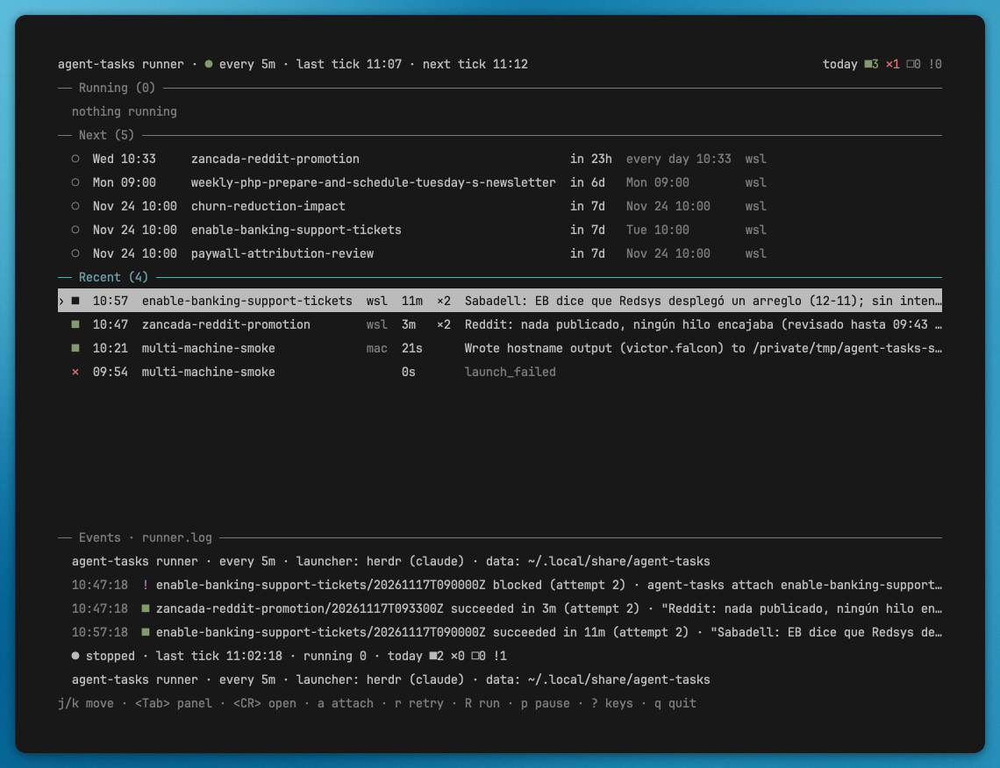

# agent-tasks

**Tell your coding agent what to do and when. A fresh agent does it on time.**

```text
You: every Monday at 9, check the outdated dependencies of this repo and
     write a short report in reports/deps.md. Tell me when it's done.

Agent: Scheduled "weekly-deps-report": every Monday at 09:00 (Europe/Madrid),
       next run Mon Nov 23. You'll get a notification with the summary.
```

On Monday at 9 a new agent opens in its own terminal tab, in that folder,
does the work, reports what it did and closes itself. You get a notification
with its summary. If it fails, gets stuck on a question or your laptop was
asleep, that's recorded too, and you can ask your agent what happened.



Works with Claude Code (or any agent you start from a terminal), on macOS
and Linux, and best inside a terminal multiplexer: Herdr, tmux or Rex.

## Quick setup with your agent

Open your coding agent in a terminal of the multiplexer you use, and paste
this. That's the whole installation: the agent follows
[RECIPE.md](RECIPE.md), asks you what it can't guess (like which command
starts your agent), runs a test task end to end and tells you what it set up.

```text
Set up agent-tasks (https://github.com/victor-falcon/agent-tasks) on this machine.
Fetch and follow the full procedure in
https://github.com/victor-falcon/agent-tasks/blob/main/RECIPE.md
(raw: https://raw.githubusercontent.com/victor-falcon/agent-tasks/main/RECIPE.md),
step by step: check bun and git, clone the repo and run its install, detect my
terminal multiplexer and configure the launcher that opens one tab per task and
closes it when the sub-agent finishes, ask me which command starts my agent,
write my personal instructions for sub-agents, run agent-tasks config check and
agent-tasks doctor, and do the smoke test. Linking agent-tasks into
~/.local/bin and its skills into ~/.claude/skills is expected; ask me before
installing anything else (such as bun) or changing my shell profile. At the
end, report what you set up and what you could not verify.
```

At the end you'll have a tab running `agent-tasks runner`. Leave it open:
it's what starts your tasks on time. It's a plain process, not an agent, so
it costs no tokens while it waits.

## Your first task

In any project, ask your agent for something, and when:

```text
Every weekday at 8, summarize yesterday's commits in this repo into
notes/standup.md. Notify me with the summary.
```

```text
Tomorrow at 10, check whether PR #123 is green and merge it if it is.
If it isn't, leave a comment saying what's failing.
```

```text
Every morning at 7, look at yesterday's Sentry errors for this project and
open an issue for each new one.
```

Your agent uses the `schedule-agent-task` skill: it asks only what it can't
guess, writes instructions the future agent can follow without any context,
and tells you the exact times it will run. Want to see it work right away?
Ask *"run it now"*.

## Ask your agent about your tasks

You don't need to learn any command. Ask:

- *"What ran last night? Did anything fail?"*
- *"Why did the Sentry task fail this morning? Retry it."*
- *"Move the deps report to Tuesdays and give it an hour."*
- *"Pause the standup notes until next week."*
- *"Keep the PR task's session open when it finishes, so I can keep talking
  to it."*

## Watch it work

The runner tab is also a live dashboard (the screenshot above): what's
running, what's next, recent results with the agent's summary. Open a run to
read its output, attach to its tab, retry it or run a task now, with Vim
keys (`?` lists them). Open the same dashboard anywhere with
`agent-tasks top`, or get a one-screen check with `agent-tasks status`.

When an agent is stuck on a question, the run shows as blocked and you get
a notification; `agent-tasks attach <run_ref>` (or `a` in the dashboard)
takes you to its tab.

## How it works

```
agent-tasks runner                 plain process in a tab, no LLM; ticks every 5m
  │
  │ launcher "launch"              Herdr tab, tmux window, Rex window, child process…
  ▼
sub-agent  "/run-agent-task <run_ref>"
  ├─ agent-tasks task <run_ref>    reads what to do
  ├─ … does the work in the task's folder …
  └─ agent-tasks finish <run_ref>  records the result, then launcher "close"
                                   closes the sub-agent's own tab
```

- **One fresh agent per run**, in the task's folder, with only the task's
  instructions and your personal instructions for sub-agents.
- **Nothing gets lost.** Agents that die without reporting, runs past their
  timeout and slots that passed while the runner was stopped are all
  recorded, with the reason.
- **Your data stays yours**: plain JSON files in `~/.local/share/agent-tasks/`,
  your config in `~/.config/agent-tasks/`.
- **Tasks can run on other machines** over SSH: schedule from your laptop,
  run on your desktop. Ask your agent to follow
  [Multiple machines](RECIPE.md#multiple-machines).

## Presets

How each run gets its terminal. The setup picks the one for the terminal
it runs in.

| Preset | Where each run goes | Notes |
|---|---|---|
| `herdr` | Its own Herdr tab, nested under the runner | Knows when an agent is working, idle or blocked. The most complete option. |
| `tmux` | Its own tmux window | No agent state: blocked agents are only caught by the timeout. tmux 3.0+. |
| `rex` | Its own Rex window in the runner's session | **Untested against a real Rex.** Needs `rex` and `jq`. |
| `process` | A background process, output in the run's log | No terminal: the agent runs non-interactively (`claude --print`). For machines without a multiplexer. |

Something else (WezTerm, Orca, your own tool)? Ask your agent to write a
[custom launcher](RECIPE.md#3a-a-custom-launcher).

## Going further

Prefer doing it by hand, or want the details? [The guide](doc/guide.md) has
the manual installation, creating and managing tasks with the CLI, every
command, run statuses, notifications, configuration, multiple machines,
troubleshooting, updating and uninstalling.

## Development

```sh
bun install
bun test             # tests never touch your real home
bunx tsc --noEmit    # type check
bin/agent-tasks help
```

See [Development](doc/guide.md#development) for the end-to-end test and the
code layout, and the design docs in [doc/roadmap/](doc/roadmap/README.md).

## License

[MIT](LICENSE)
